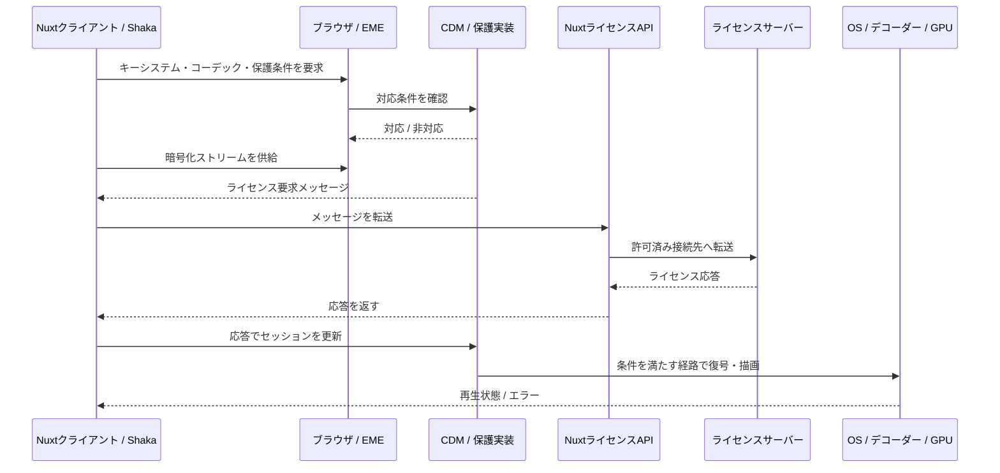

# ハードウェア保護要求の仕組みと実装

確認日：2026-10-12。対象実装はNuxtとShaka Player 5.2.13を使うveilframe。これは技術解説であり、新しい仕様の決定ではない。実機での操作は[運用・検証手順](operations.md)、採用理由は[PlayReadyの設計判断](ard/261012-playready-on-windows.md)を参照する。

## 1. ハードウェア保護要求が意味すること

Webアプリは「この動画を、この保護能力を持つ再生経路で再生してほしい」とブラウザへ要求する。JavaScriptが安全なデコーダーやGPU領域を作るわけではない。ブラウザ、CDM、OS、ハードウェアが条件を満たす場合に、その再生経路を利用できる。

EMEは暗号化メディアを扱う共通APIで、DRM方式自体を定義しない。対応確認には暗号方式、コーデック、保護要件などの組み合わせが関係する。APIが成功しても、ライセンス取得、復号、出力、実際の再生が成功するかは別に確認する必要がある。[W3C EME仕様](https://www.w3.org/TR/encrypted-media/)

次の4点を分けて考える。

| 項目                   | 設定・確認する主体             | 意味                                              |
| ---------------------- | ------------------------------ | ------------------------------------------------- |
| クライアントの再生要求 | Webアプリ                      | Widevineのrobustness、PlayReadyのキーシステムなど |
| 端末の保護能力         | ブラウザ・CDM・OS・機器        | 要求された保護経路を利用できるか                  |
| ライセンスの制約       | 配信事業者・ライセンスサーバー | 鍵の利用に必要な最低保護条件、期限、出力制限など  |
| キャプチャ結果         | 実際の撮影手段で観測           | 画面に見える映像が取得画像に含まれるか            |

veilframeの記録にある`robustness`は**要求した条件**である。実機の認証レベルや、キャプチャを防止できたという証明を記録する項目ではない。

## 2. 再生経路と保護される境界



図は概念図で、各OSの内部プロセス構成を表すものではない。Shakaはストリーム処理とEMEセッション管理を担い、NuxtのライセンスAPIは通信を仲介する。今回の実装では、アプリが復号鍵を取り出してCanvasへ描画する処理はない。

ソフトウェアの通常メモリと、ハードウェアによって隔離された実行・メディア処理領域は区別される。PlayReady SL3000では、TEEを使うハードウェア保護が定義されている。GPUによる高速なデコードが有効というだけでは、その保護能力を確認したことにならない。[Microsoft：Security Level](https://learn.microsoft.com/en-us/playready/overview/security-level)

WindowsのProtected Media Pathは、信頼するコンポーネントや出力を通して保護コンテンツを処理するための背景資料になる。ただし、この資料の歴史的なMedia Foundation構成を、現在のEdge内部構成と一対一で対応させて断定しない。[Microsoft：Protected Media Path](https://learn.microsoft.com/en-us/windows/win32/medfound/protected-media-path)

## 3. WidevineとPlayReadyの要求方法

### Widevine：robustnessで要求する

Widevineのキーシステムは`com.widevine.alpha`。Shakaの設定では、映像と音声それぞれにrobustnessを指定できる。`SW_SECURE_CRYPTO`、`SW_SECURE_DECODE`、`HW_SECURE_CRYPTO`、`HW_SECURE_DECODE`、`HW_SECURE_ALL`は異なる保護条件であり、ハードウェア関連の値も同じ要求ではない。[Shaka：DRM Configuration](https://shaka-project.github.io/shaka-player/docs/api/tutorial-drm-config.html)

veilframeの保護モードは映像・音声とも`HW_SECURE_ALL`を1候補だけ指定する。通常モードは配列を空にする。空の設定を「保護が存在しない」とは解釈しない。DRMは使うが、このアプリから保護モードの条件を明示要求していない、という意味である。

```ts
player.configure({
  drm: {
    servers: {
      'com.widevine.alpha': '/api/license/shaka-widevine',
    },
    preferredKeySystems: ['com.widevine.alpha'],
    advanced: {
      'com.widevine.alpha': {
        videoRobustness: ['HW_SECURE_ALL'],
        audioRobustness: ['HW_SECURE_ALL'],
      },
    },
  },
});
```

これは設定部分を抜粋した説明用コード。実際にはライセンス要求先・キーシステムの検査、エラー処理、プレイヤー破棄も必要になる。

`['HW_SECURE_ALL', 'SW_SECURE_CRYPTO']`のように弱い候補を追加すると、ハードウェア条件が通らなくても別条件で再生できる可能性がある。今回の検証では条件を緩和しない。[Shaka：robustness候補の設定](https://shaka-project.github.io/shaka-player/docs/api/tutorial-drm-config.html)

Widevineの端末セキュリティレベルと、Webで要求するrobustnessは異なる観点の情報である。端末の表示がL1でも、任意のブラウザ・コーデック・音声条件で`HW_SECURE_ALL`が通るとは判断しない。使用するブラウザのEME交渉と実際の再生で確認する。Widevine全体の構成は[Google公式概要](https://developers.google.com/widevine/drm/overview?hl=ja)を参照する。

### PlayReady：専用のキーシステムで要求する

Windows Edge向けのMicrosoft資料では、通常の`com.microsoft.playready.recommendation`はSL2000、`com.microsoft.playready.recommendation.3000`は対応ハードウェアでSL3000を使う。旧`com.microsoft.playready`は非推奨である。[Microsoft：EME Key System Strings](https://learn.microsoft.com/en-us/playready/overview/key-system-strings)

veilframeは保護モードで`.3000`を選ぶ。Widevineの`HW_SECURE_ALL`をPlayReadyへ流用せず、音声robustnessも明示しない。Shaka資料にもPlayReadyの音声ハードウェアDRMの制約が記載されている。[Shaka：PlayReady設定](https://shaka-project.github.io/shaka-player/docs/api/tutorial-drm-config.html)

```ts
const keySystem = 'com.microsoft.playready.recommendation.3000';

player.configure({
  drm: {
    servers: {
      [keySystem]: '/api/license/microsoft-playready',
      'com.microsoft.playready': '/api/license/microsoft-playready',
    },
    preferredKeySystems: [keySystem],
    keySystemsMapping: {
      'com.microsoft.playready': keySystem,
    },
    advanced: {
      [keySystem]: {
        videoRobustness: [],
        audioRobustness: [],
        serverCertificateUri: '',
      },
    },
  },
});
```

マニフェストから認識される基底のPlayReady識別子を、要求したキーシステムへ対応させる。優先順位の指定だけで他方式を禁止できたとみなさず、実際に選ばれた方式も検査する。Widevine用の証明書URLはPlayReadyへ渡さない。

| veilframeの条件 | キーシステム                                  | 映像                 | 音声            |
| --------------- | --------------------------------------------- | -------------------- | --------------- |
| Widevine・通常  | `com.widevine.alpha`                          | 明示要求なし         | 明示要求なし    |
| Widevine・保護  | `com.widevine.alpha`                          | `HW_SECURE_ALL`      | `HW_SECURE_ALL` |
| PlayReady・通常 | `com.microsoft.playready.recommendation`      | SL2000のキーシステム | 既定条件        |
| PlayReady・保護 | `com.microsoft.playready.recommendation.3000` | SL3000のキーシステム | 既定条件        |

最後の行を「映像と音声の両方がSL3000」と説明してはいけない。

## 4. EMEを直接使った対応確認

次はShakaの設定とは別の、APIを理解するための例。画面や自動判定機能には追加していない。

```ts
const access = await navigator.requestMediaKeySystemAccess(
  'com.widevine.alpha',
  [
    {
      initDataTypes: ['cenc'],
      sessionTypes: ['temporary'],
      videoCapabilities: [
        {
          contentType: 'video/mp4; codecs="avc1.42E01E"',
          robustness: 'HW_SECURE_ALL',
        },
      ],
      audioCapabilities: [
        {
          contentType: 'audio/mp4; codecs="mp4a.40.2"',
          robustness: 'HW_SECURE_ALL',
        },
      ],
    },
  ],
);

console.log(access.keySystem, access.getConfiguration());
```

HTTPSなどのsecure contextで、クライアント側から呼ぶ。コーデック値は例示であり、実際の素材のプロファイル・レベル・音声形式に合わせる。成功はその構成の対応確認で、動画の再生や撮影防止の確認ではない。失敗はAPI非対応、構成非対応、環境・権限の制約などを切り分ける。[MDN：requestMediaKeySystemAccess](https://developer.mozilla.org/en-US/docs/Web/API/Navigator/requestMediaKeySystemAccess)

独自に再生まで実装する場合は、`createMediaKeys()`、動画への`setMediaKeys()`、セッション生成、初期化データからの`generateRequest()`、`message`イベントでのライセンス取得、`session.update()`、鍵の状態・期限・終了処理まで必要になる。veilframeではこのセッション管理をShakaへ委譲している。[W3C EME API](https://www.w3.org/TR/encrypted-media/)

## 5. Nuxt実装で条件を維持する

### アダプターとライフサイクル

再生の実体は[`create-shaka-player.ts`](../src/entities/playback/api/create-shaka-player.ts)、抽象契約は[`playback-port.ts`](../src/entities/playback/model/playback-port.ts)、操作の制御は[`create-playback-controller.ts`](../src/features/play-media/model/create-playback-controller.ts)にある。

1. SSRでShakaを初期化せず、クライアントの操作から動的importする。
2. DRM方式とモードから要求するキーシステムを決める。
3. ライセンス要求フィルターを登録してから、設定・ロードを行う。
4. ライセンス要求の`message.drmInfo?.keySystem`が要求方式と一致しなければ拒否する。
5. 要求のURLを選択済みNuxt APIに固定する。
6. ロード後も`player.drmInfo()?.keySystem`を検査し、一致した場合に`video.play()`する。
7. 条件変更や終了ではプレイヤーを破棄する。非同期処理の古い完了が新しい状態を上書きしないよう制御する。

Shakaのプリロード中は、Player側の`drmInfo()`がまだ取得できないことがある。ライセンス要求時は、その要求に付属するDRM情報を検査する。ロード後の検査だけでは、意図しない方式のライセンス通信を事前に止められない。[Shaka API：RequestとDrmInfo](https://shaka-project.github.io/shaka-player/docs/api/shaka.extern.html)

`REQUESTED_KEY_SYSTEM_CONFIG_UNAVAILABLE`は今回のアダプターでは非対応に分類する。HTTP失敗、ライセンス拒否、デコード失敗などをすべて同じ「ハードウェアがない」にまとめない。詳細な契約レビューは[インターフェイスレビュー](interface-review.md)を参照する。

### ライセンスAPI

ブラウザは接続IDで[`/api/license/[id]`](../server/api/license/[id].post.ts)を呼ぶ。URLと秘密の認証ヘッダーはサーバー側の設定に置く。転送実装は[`create-license-transport.ts`](../server/infrastructure/create-license-transport.ts)。

| 転送項目       | Widevine                   | PlayReady                                                             |
| -------------- | -------------------------- | --------------------------------------------------------------------- |
| リクエスト本文 | CDMの要求をバイト列で転送  | SOAP XMLの要求をバイト列で転送                                        |
| Content-Type   | `application/octet-stream` | `text/xml; charset=utf-8`                                             |
| SOAPAction     | なし                       | `"http://schemas.microsoft.com/DRM/2007/03/protocols/AcquireLicense"` |
| 応答           | バイト列のまま返す         | バイト列のまま返す                                                    |

XMLを独自に組み立てたり、DRM応答をJSONに変換したりしない。SOAPActionは今回のMicrosoftテストサービスに合わせた値で、別事業者のゲートウェイを導入する際はその仕様を確認する。[Microsoftテストサービス：AcquireLicense](https://test.playready.microsoft.com/service/rightsmanager.asmx?op=AcquireLicense)

要求・応答は各1 MiB、タイムアウト15秒、リダイレクトと自動再試行を禁止する。独自接続はローカル限定で、公開Vercel環境には持ち込まない。Nuxtプロキシを置くこと自体で端末のDRM能力は増えない。

## 6. 配信側で必要になるもの

暗号化動画、DRM初期化情報を持つマニフェスト、対応する鍵を発行するライセンスサービスが必要になる。通常のMP4にプレイヤーの保護設定を追加するだけでは、DRM素材にはならない。パッケージングと再生は別工程である。[Shaka Packager：DRM](https://shaka-project.github.io/shaka-packager/html/tutorials/drm.html)

PlayReadyにはクライアントの能力と、ライセンスの`MinimumSecurityLevel`という最低条件がある。クライアントが最低条件を満たせなければ、そのライセンスを利用できない。事業者はクライアント証明書のレベルを踏まえた発行制御もできる。[Microsoft：Security Levelとライセンス](https://learn.microsoft.com/en-us/playready/overview/security-level)

現在の公開PlayReady接続はMicrosoftのテスト動画で、URL設定は`cfg=(persist:false,sl:150)`。これはライセンスの最低条件である。一方、保護モードのアプリは`.recommendation.3000`を要求する。したがって、このPoCは「クライアントがSL3000の要求を受け入れるか」を検証するが、「サーバーがSL3000以外を拒否する配信ポリシー」を検証したとは言えない。[Microsoft：テストサービス設定](https://testweb.playready.microsoft.com/Server/ServiceQueryStringSyntax)、[Shaka公式デモ素材設定](https://github.com/shaka-project/shaka-player/blob/main/demo/common/assets.js)

独自配信で映像に最低SL3000を課す際は、音声の制約も考慮する。Microsoftのテストサービス資料は映像鍵と音声鍵を分け、別の最低レベルを設定する例を示している。単一の鍵・条件で両方をSL3000にすると、音声の対応制限で再生できない可能性がある。今回の公開接続設定は変更していない。[Microsoft：映像・音声のライセンス条件](https://testweb.playready.microsoft.com/Server/ServiceQueryStringSyntax)

## 7. スクリーンショット・HDCP・出力制限の違い

ハードウェア保護要求は、Webページ全体をOSキャプチャから除外する設定ではない。対象は暗号化されたメディアの処理経路であり、周囲のDOM、ボタン、文字へ同じ保護が適用されるわけではない。EME仕様は一般のHTML要素を撮影禁止にするAPIを提供していない。[W3C EME仕様](https://www.w3.org/TR/encrypted-media/)

保護された映像経路が使われる環境では、キャプチャから映像が除外され、黒い領域として観測される可能性がある。ただし、SL3000や`HW_SECURE_ALL`への要求成功を、すべての撮影方法で黒くなる保証に置き換えない。今回の実装の結論は、対応交渉・再生結果・実際の撮影結果の3つを別々に保存することで確かめる。

HDCPは主にディスプレイとのデジタル接続の保護に関係する。スクリーンショットの黒画面化とは別の確認事項である。PlayReadyのOutput Protection Levelは出力に最低条件を課し、接続先が条件を満たさない場合は出力を止めることがある。[Microsoft：Output Protection Levels](https://learn.microsoft.com/en-us/playready/overview/output-protection-levels)

EMEの鍵状態には`output-restricted`や`output-downscaled`があり、ライセンスを取得できても出力条件を満たせない状態があり得る。これらの監視は追加の診断方法であり、現行veilframeの画面へ状態表示を追加したという意味ではない。[W3C：MediaKeyStatus](https://www.w3.org/TR/encrypted-media/#dom-mediakeystatus)

## 8. Windows 11のBraveで失敗する背景

利用者の報告は、Windows 11 / Brave 1.97.56 / Chromium 155.0.8059.40で、通常Widevineは再生できて映像がスクリーンショットに写る一方、ハードウェア保護要求は非対応になる、というもの。

確認日のChromium mainの`GetRobustnessConfigRule`には、WindowsのWidevineで`HW_SECURE_CRYPTO`以上を拒否する分岐がある。この実装は、報告された挙動を説明する有力な背景になる。ただし、参照したmainが利用者のBraveビルドと完全に同じソースであることは確認していない。[Chromium公式実装](https://chromium.googlesource.com/chromium/src/+/refs/heads/main/components/cdm/renderer/widevine_key_system_info.cc)

そのため、Windowsの検証対象にEdge＋PlayReadyを追加した。BraveへPlayReadyを指定すれば同じ結果になるとは想定していない。またEdgeを使うだけでSL3000対応になるわけでもない。要求するキーシステムを機器が利用できる必要がある。[Microsoft：対応するキーシステム](https://learn.microsoft.com/en-us/playready/overview/key-system-strings)

## 9. 検証の進め方と失敗の切り分け

### 実機での確認順序

1. OS、ブラウザと版、GPU、ドライバー、モニター・接続方式を控える。実機の情報を確認し、不明な情報は推測しない。
2. HTTPSまたは許可されるローカル環境で、選んだDRMの通常モードを再生する。
3. 同じ素材・接続で保護モードを要求し、非対応と再生失敗を区別する。
4. 再生が継続している映像を目視し、OS標準キャプチャで撮影する。
5. 得られた画像で動画部分と周囲のUIを確認し、方法・結果・画像を記録する。
6. 別のモニターやキャプチャ手段は別条件の結果として扱う。1回の黒画面を全環境へ一般化しない。

| 観測                             | 次に確認する点                                   | その観測だけでは言えないこと |
| -------------------------------- | ------------------------------------------------ | ---------------------------- |
| APIがない                        | secure context、ブラウザ対応                     | ハードウェア故障             |
| キーシステム構成が非対応         | DRM、映像・音声コーデック、要求条件              | DRM動画が一切再生できない    |
| ライセンスAPIが失敗              | 許可接続、HTTP、本文・ヘッダー、サイズ・時間制限 | GPUがSL3000非対応            |
| ライセンスは取得できるが再生不可 | 鍵、素材、デコード、出力条件                     | 撮影防止が成立している       |
| 再生でき、映像が写る             | 実際の方式、モード、キャプチャ条件               | DRMが使われていない          |
| 再生でき、映像部分が黒い         | 目視で動いているか、別方式の撮影との比較         | あらゆる手段で取得不可能     |

### 自動テストで確認する範囲

単体テストは要求値、DRM不一致の拒否、ライセンス転送、非対応処理、状態競合、保存と互換性を検証する。Playwrightはテスト用の再生実装で画面と記録を確認する。どちらも実機CDM・TEE・GPU・OSキャプチャの検証を代替しない。カバレッジ100%はアプリコードの実行範囲の指標で、ハードウェア保護の認証結果ではない。[テスト方針](testing.md)、[実施済み検証](verification.md)

## 10. 参照資料の読み方

| 資料                                                                                                                                          | 主に確認できる内容                                    |
| --------------------------------------------------------------------------------------------------------------------------------------------- | ----------------------------------------------------- |
| [W3C EME](https://www.w3.org/TR/encrypted-media/)                                                                                             | 共通API、構成交渉、セッション、鍵状態                 |
| [MDN requestMediaKeySystemAccess](https://developer.mozilla.org/en-US/docs/Web/API/Navigator/requestMediaKeySystemAccess)                     | APIの呼び出し方、secure context、例外                 |
| [Google Widevine概要・日本語](https://developers.google.com/widevine/drm/overview?hl=ja)                                                      | DRM、配信サービス、CDM、プレイヤーの関係              |
| [Shaka DRM Configuration](https://shaka-project.github.io/shaka-player/docs/api/tutorial-drm-config.html)                                     | キーシステムとrobustnessの設定                        |
| [Microsoft Key System Strings](https://learn.microsoft.com/en-us/playready/overview/key-system-strings)                                       | `.recommendation`と`.recommendation.3000`の違い       |
| [Microsoft Security Level](https://learn.microsoft.com/en-us/playready/overview/security-level)                                               | SL150・SL2000・SL3000、クライアントとライセンスの条件 |
| [Microsoft Output Protection Levels](https://learn.microsoft.com/en-us/playready/overview/output-protection-levels)                           | 出力条件、HDCPとの関係                                |
| [Microsoft Protected Media Path](https://learn.microsoft.com/en-us/windows/win32/medfound/protected-media-path)                               | Windows保護メディア経路の背景                         |
| [Chromium Widevine実装](https://chromium.googlesource.com/chromium/src/+/refs/heads/main/components/cdm/renderer/widevine_key_system_info.cc) | OSごとの保護条件の扱い                                |
| [Shaka Packager DRM](https://shaka-project.github.io/shaka-packager/html/tutorials/drm.html)                                                  | 暗号化素材を作る工程                                  |

リンク先の最新資料やmainブランチは将来変わる。障害調査では実際のブラウザ・Shakaのバージョンに対応する仕様とソースも確認する。
